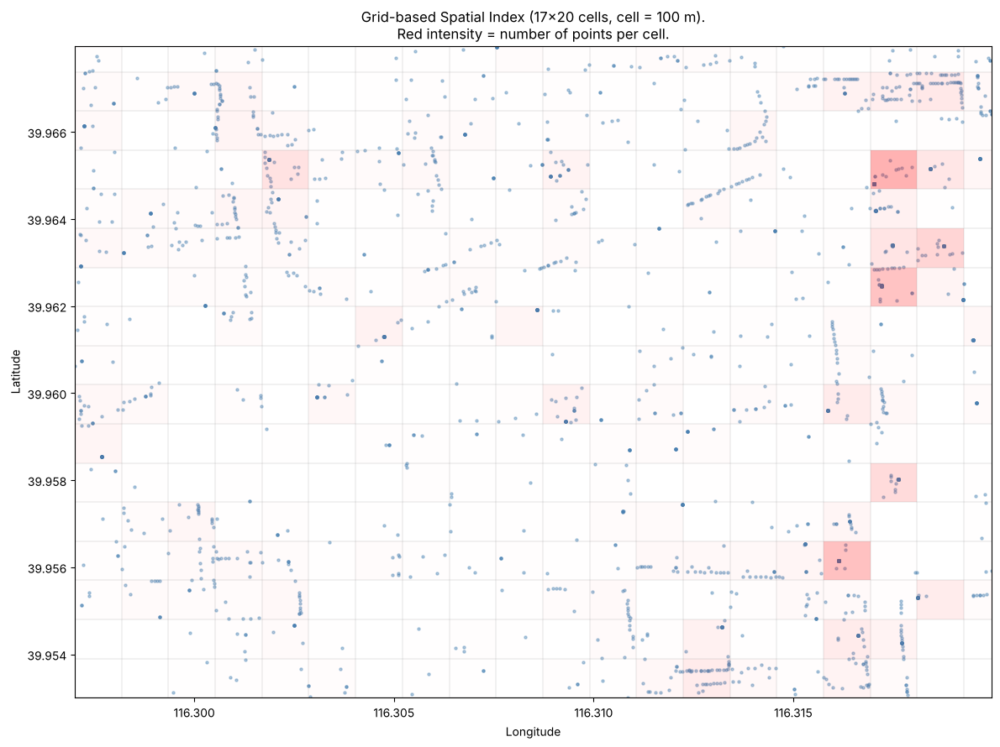
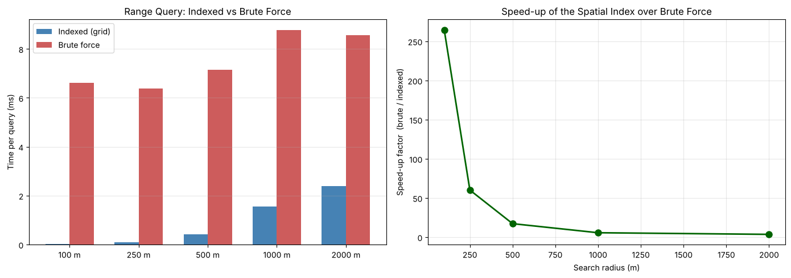
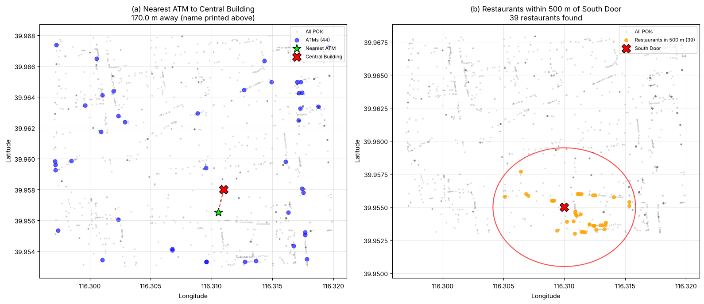

# Spatial Indexing from Scratch

A grid-based spatial index written in plain Python, with no indexing libraries, that answers
**range** and **nearest-neighbour** queries over 2,159 points of interest around the Beijing
Institute of Technology campus. Every indexed query is checked against a brute-force scan, and
both always return the same result.

[](https://colab.research.google.com/github/maximofox338/spatial-indexing/blob/main/spatial_indexing.ipynb)



## Results

The two questions from the assignment, answered with the index:

| Question | Answer | Indexed | Brute force |
|---|---|---|---|
| Nearest ATM to the Central Building | 170 m away | 0.05 ms | 7.4 ms |
| Restaurants within 500 m of the South Door | 39 restaurants | 0.35 ms | 10.4 ms |

Range queries around the same point at increasing radii:

| Radius | Results | Indexed | Brute force | Speed-up |
|---|---|---|---|---|
| 100 m | 0 | 0.025 ms | 6.6 ms | 265× |
| 250 m | 6 | 0.106 ms | 6.4 ms | 60× |
| 500 m | 35 | 0.414 ms | 7.1 ms | 17× |
| 1000 m | 154 | 1.55 ms | 8.8 ms | 6× |
| 2000 m | 282 | 2.39 ms | 8.6 ms | 4× |

Nearest-neighbour queries from five points across the campus ran **48× to 294×** faster than the
brute-force scan.

The index wins by a wide margin when a query touches few cells and the advantage shrinks as the
radius grows, because a large radius forces it to visit most of the grid anyway. Timings change
slightly from run to run and between machines. As the assignment asks, the brute-force baseline
re-reads the CSV on every call, so its time includes file reading.





## How it works

- **Index building.** The bounding box of the data is split into uniform cells of about
  100 m × 100 m (17 × 20 cells, 263 of them non-empty), and an inverted index maps each cell to
  the points inside it. Cell size is set in metres and converted to degrees with the cosine of
  the mean latitude, so cells stay square on the ground.
- **Range query.** Finds the cells that intersect the query rectangle or circle, then filters
  their points by exact haversine distance and by a regular expression on the POI type code.
- **Nearest-neighbour query.** Starts at the cell containing the query point and expands outward
  in rings, keeping the best candidate so far. It stops once the ring is farther away than that
  candidate, so the answer is exact, not approximate.
- **Baselines.** `RangeScan` and `NNScan` answer the same queries by scanning every point.

## Run it

Open the notebook in Colab with the badge above, or locally:

```bash
pip install -r requirements.txt
jupyter notebook spatial_indexing.ipynb
```

The dataset is included in `data/`. If it is missing, the first cell downloads it from this
repository.

## Context

Individual assignment for *Data Science and Algorithms*, Beijing Institute of Technology,
spring 2026. The POI dataset was provided by the course.
